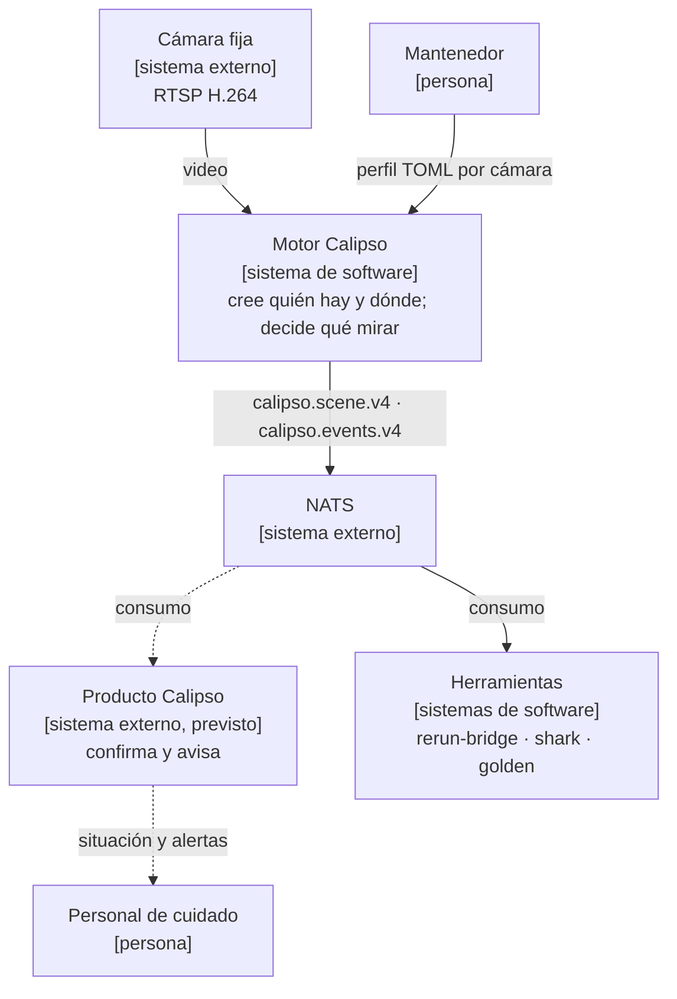
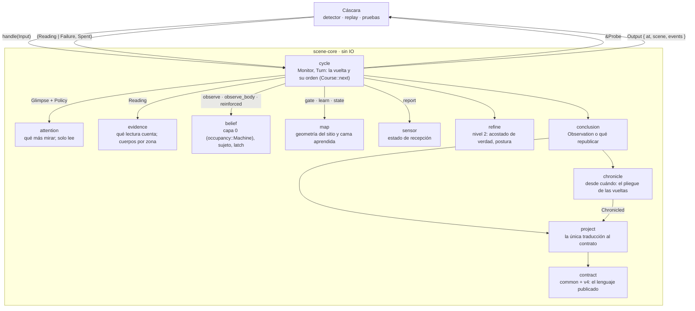
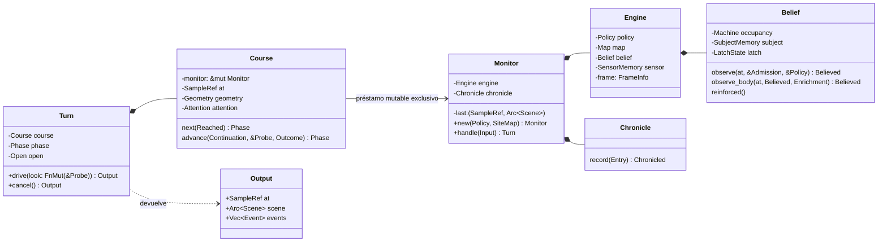
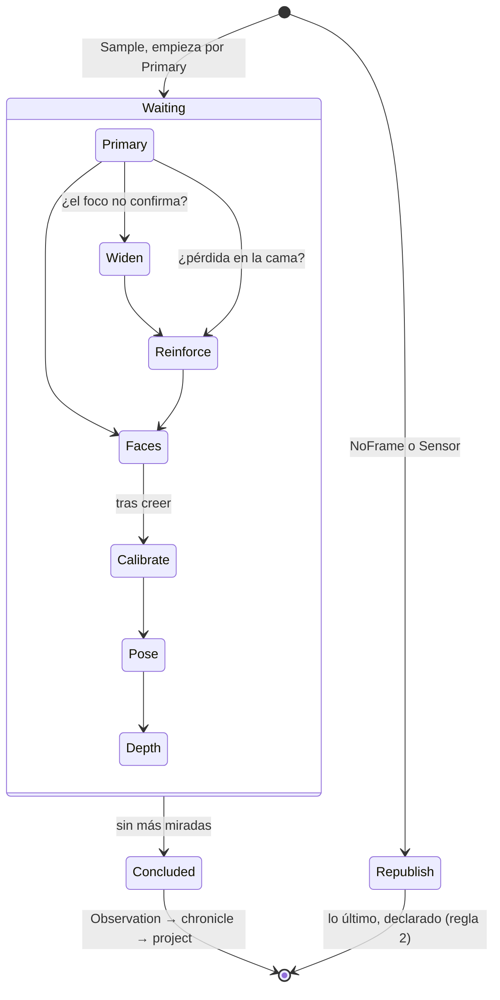
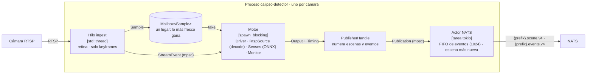
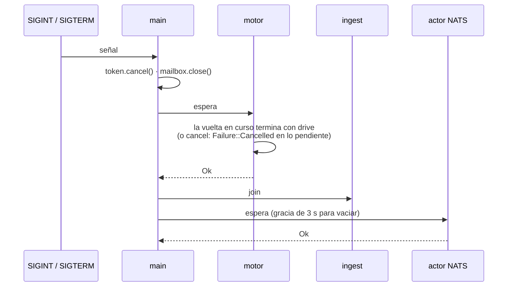
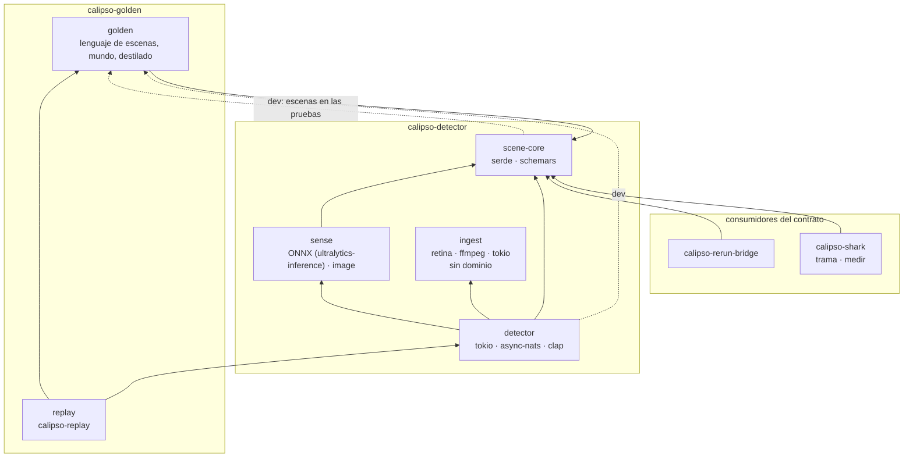
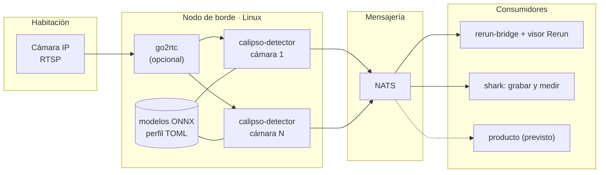
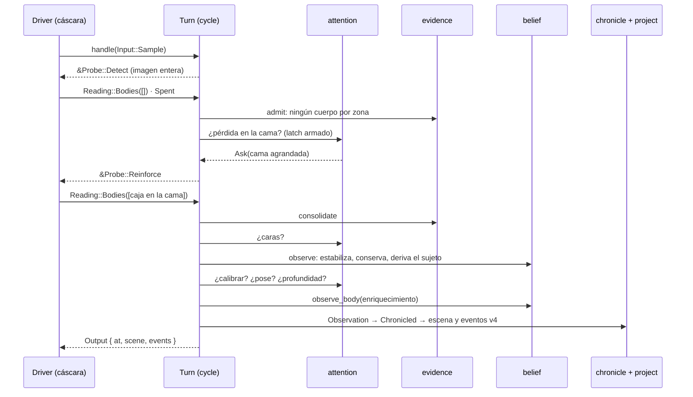

# Arquitectura: 4+1 vistas, con C4 y UML

Revisión del código al **2026-10-11**: contrato v4, protocolo `drive`/`cancel`.
Describe lo implementado; lo previsto se marca como tal. Si este documento y el
código no coinciden, uno de los dos tiene un error: la referencia del motor es
[`scene-core/DESIGN.md`](../calipso-detector/crates/scene-core/DESIGN.md), que
se compila con `cargo doc`.

El documento sigue las **4+1 vistas** de Kruchten (1995). Cada vista responde
una pregunta para alguien, y los niveles de **C4** (Brown) se ubican en la vista
a la que pertenecen. Los diagramas son Mermaid: `flowchart` para C4 (más estable
que el `C4Context` experimental) y los diagramas UML nativos (`classDiagram`,
`stateDiagram`, `sequenceDiagram`).

| Vista | Pregunta | Para quién | Diagramas |
| --- | --- | --- | --- |
| [Contexto](#0-contexto-c1) | ¿Qué es y con quién habla? | todos | C1 |
| [Lógica](#1-vista-lógica) | ¿Qué piezas tiene el motor y qué se dicen? | quien diseña o revisa | C3, clases UML, estados UML |
| [Procesos](#2-vista-de-procesos) | ¿Qué corre a la vez y cómo se apaga? | quien opera o integra | C2, secuencia UML |
| [Desarrollo](#3-vista-de-desarrollo) | ¿Cómo está partido el código y qué lo vigila? | quien contribuye | paquetes |
| [Física](#4-vista-física) | ¿Dónde corre? | quien despliega | despliegue |
| [Escenarios (+1)](#5-escenarios-1) | ¿Cómo se sostienen las cuatro vistas en un caso real? | todos | secuencia UML |

## Resumen

El motor es una **biblioteca Rust con estado, determinista y sin IO**,
`scene-core`: una función de `(Policy, SiteMap, Input*, Reading*)`. La conduce
un **proceso por cámara**, `calipso-detector`, que recibe RTSP, decodifica bajo
demanda, mira con modelos ONNX y publica `calipso.scene.v4` y
`calipso.events.v4` en NATS. Los consumidores leen solo el contrato publicado.

El motor hace una cosa: **publica la escena y los eventos de cada muestra**,
como un pipe. Suavizar en el tiempo, confirmar y avisar es de quien consume.

Una crate es una unidad de código, no un contenedor C4. Ingesta, sentidos,
núcleo y publicación corren **en un mismo proceso**, en hilos con un dueño
cada uno. No son microservicios.

## 0. Contexto (C1)



El residente es la persona observada; el motor no identifica a nadie y no
guarda imágenes (regla 7). Las alertas son del producto que consume.

## 1. Vista lógica

### Componentes del núcleo (C3)



Las flechas son las únicas conversaciones permitidas:

- **`cycle` solo secuencia** (regla 11). Le pasa la `Policy` entera a quien
  decide y nunca pregunta qué sentido está configurado; `check.sh` lo vigila.
- **`attention` lee y nunca escribe** la creencia: recibe un `Glimpse` y
  devuelve `Consideration<T>`, que es `Ask(T)` o `Skip(reason)` y siempre va al
  ledger (regla 12).
- **El dominio no importa el contrato.** Solo `project` traduce, y `cycle`
  nombra el contrato porque `Output` lo lleva. La proyección común
  (`project/mod.rs`) nombra solo `contract::common`, para que una versión nueva
  la comparta sin depender de v4 (C2). Las dos cosas las vigila `check.sh`.
- **El motor no lee lo publicado** (P4). `chronicle` recuerda el dominio fuera
  del motor y `project` lo traduce.

Lo público de la biblioteca es `Monitor`, `Turn`, `Input`, `Output`, `contract`
(con `contract::v4`), `look` (`Probe`, `Reading`, `Failure`, `Spent`), `policy`,
`map` (`SiteMap`, `FrameInfo`) y `geom`. Todo lo demás es `pub(crate)`, y
`#![warn(unreachable_pub)]` impide que un `pub` diga más de lo que alcanza.

### Las clases que sostienen la vuelta (UML)



- `Turn` toma prestado `&mut Monitor`: el compilador impide abrir dos vueltas a
  la vez.
- `Open` es la obligación de cerrar: solo `drive` la descarga. Una vuelta
  soltada sin cerrar dispara la aserción de `Drop` (regla 10).
- El shell no tiene nada que usar mal: recibe una `&Probe` y devuelve lo que
  vio. Una lectura de otra clase que la sonda cuenta como un sentido que falla
  (`Failure::Model`), no como un pánico (regla 21).

### Los estados de una vuelta (UML)



Cada espera lleva lo que la vuelta juntó hasta ahí (`Continuation`), así que no
se puede seguir con datos de menos. Cada mirada es opcional salvo la primaria y
la decide `attention`. El orden vive en un solo lugar:

```text
Primary(foco | entero) → [Widen] → [Reinforce] → [Faces] → believe → [Calibrate] → [Pose → [Depth]] → conclude
```

### La capa 0 por dentro

```text
Bodies ──► Span ──(Before, Seen)──► settle ──[Movement]──► Machine::apply ──► Transition
            cuándo cambió             qué lo explica         retenidos, sin explicar,
            (dwell en tiempo de       (las seis reglas)      hechos en orden
             fuente)
```

La máquina devuelve la transición como valor y no la emite (P2). Quien la
recibe no necesita preguntarle nada (P6). La cuenta publicada satisface:

```text
room.occupants = floor.seen + bed.seen + len(bed.held)
rbh            = (occupants, bed.seen + held, held)
```

## 2. Vista de procesos

### Contenedores y ejecución (C2)



- **Cada recurso nace y muere en su hilo** (`detector/src/main.rs`). Nada se
  comparte salvo el buzón y dos canales.
- **El buzón no encola.** Lo que el motor no toma a tiempo lo reemplaza la
  muestra siguiente, y solo se decodifica lo que el motor va a mirar.
- **El driver no sabe de dónde vienen las muestras ni quién mira.** Se le
  inyectan una `SampleSource` y un `SensesPort`. En vivo son `RtspSource` y
  `sense::Senses`; en `calipso-replay`, una escena golden y su mundo guionado:
  el mismo driver, el mismo núcleo y el mismo publicador.
- **El transporte se vuelve dominio en un solo lugar.** El driver traduce cada
  `StreamEvent` a `Input::Sensor` (conectando, transmitiendo, sin muestras,
  reconectando) y vigila el plazo sin muestras.
- **La escena nunca espera.** El actor reintenta el frente de la cola de eventos
  con id de mensaje NATS, y de la escena publica siempre la más nueva.
- **Prefijo:** `vision.<site>.<camera>`, salvo que el perfil lo cambie.

### El apagado (UML)



Ninguna vuelta queda abierta: un apagado a mitad de una mirada es un sentido
que falla, y el dominio ya sabe interpretarlo.

## 3. Vista de desarrollo

### Paquetes y dependencias



- `scene-core` depende solo de `serde` y `schemars`. Clippy prohíbe relojes,
  archivos, red e hilos (`clippy.toml`). `check.sh` verifica en el árbol de
  dependencias que no entren tokio ni async-nats.
- `ingest` no conoce el dominio y `sense` no conoce el transporte asíncrono;
  `check.sh` vigila los dos.
- Los consumidores usan `scene_core::contract::v4` para leer el contrato.
  Depender de la crate entera es deuda: un crate de solo tipos del cable (como
  las cabeceras `uapi` del kernel) los dejaría depender solo del lenguaje
  publicado (DESIGN §11).
- La flecha punteada es una dependencia de desarrollo: las pruebas del núcleo
  corren escenas golden. No hay ciclo en el código que se compila para
  producción.

### Lo que vigila el diseño

Cada regla de [`RULES.md`](../calipso-detector/RULES.md) tiene un guardián, y
cada guardián tiene una fixture que lo rompe a propósito
(`scripts/check-guardians.sh`): si el guardián no falla, el gate falla.

| Guardián | Regla o principio | Fixture |
| --- | --- | --- |
| Árbol de dependencias del núcleo sin IO | 8 | `core-depends-on-tokio` |
| Clippy: sin relojes ni hilos | 8, 9 | `core-reads-the-clock` |
| `#![deny(...)]`: sin `unwrap`, `expect` ni indexación | 21 | `core-panics` |
| `missing_docs` en la API pública | 13 | `core-undocumented` |
| Snapshots del schema y los ejemplos | 13 | `contract-changes-without-snapshot` |
| `cycle` no pregunta por la política | 11 | `cycle-consults-a-policy` |
| La proyección común no nombra una versión | C2 | `common-projection-names-a-version` |
| Pasos Gherkin sin definir | 15 | `undefined-step`, `undefined-step-shell` |

## 4. Vista física



N cámaras son N procesos, cada uno con su perfil. No hay estado compartido
entre cámaras ni persistencia: la creencia empieza de cero con el proceso, y ni
una reconexión ni un cambio de resolución sueltan a nadie. El repositorio **no
tiene manifiesto de despliegue**: «un proceso por cámara» se verifica en
`main.rs`, no en una topología operativa.

## 5. Escenarios (+1)

Cada escenario atraviesa las cuatro vistas. Están escritos en Gherkin en
`features/` y corren en el gate.

### Una muestra con alguien en la cama que se pierde



En las vistas: lógica (el orden de `Course::next`), procesos (todo ocurre en el
hilo del motor; las miradas son llamadas síncronas a `SensesPort::look`),
desarrollo (los tipos que cruzan son `Probe` y `Reading`, de `look`) y física
(un proceso, un modelo por rol).

### El decoder no entrega imagen

`Input::NoFrame` abre una vuelta que no pide nada: republica la última escena,
**declarada** (`republished.reason = decode_failed`), y lo que era actual pasa a
retenido, porque nada es actual sin una observación (regla 2). Si el que falla
es el detector principal, la vuelta conserva la creencia y la escena se
declara con `detect_failed`.

### Apagado a mitad de una mirada

La señal cancela el token. La vuelta en curso termina: lo pendiente responde
`Failure::Cancelled`, se publica la escena de esa muestra y el proceso cierra
(ver el apagado en la vista de procesos).

### Una noche sin cámara

`calipso-replay` corre una escena golden por el **mismo** driver, con una
`SampleSource` de tramos y un `SensesPort` guionado. Como el núcleo es
determinista, la misma noche da las mismas escenas, y `calipso-distill` vuelve
escena una noche publicada.

## Hallazgos y límites

| Tema | Evidencia | Consecuencia |
| --- | --- | --- |
| Consumidores de la POC | perception-bridge y scene-analytics leían v3 a través de un adaptador (proyecto 22); v3 se retiró el 2026-10-11 | **Abierto:** hay que verificar que lean v4 antes de la próxima corrida en vivo |
| Consumidores atados al núcleo | rerun-bridge y shark dependen de `scene-core` para leer el contrato | Deuda: un crate de tipos del cable (DESIGN §11) |
| `Input::Sensor` | lleva un `SampleRef` que el driver toma de la última muestra | Deuda: requiere que `observed_at` sea opcional en la próxima versión del contrato |
| `last_event_seq` | lo escribe el actor NATS, no el núcleo | Deuda de contrato (DESIGN §11) |
| Profundidad | `meters` y `reference_m` llevan la escala relativa del modelo | Se renombran en la próxima versión del contrato |
| Despliegue | sin manifiesto en el repositorio | La topología se describe acá; no se verifica |

## Verificación de esta revisión

`scripts/check.sh` en verde al 2026-10-11:

- formato y clippy con `-D warnings`;
- árboles de dependencias del núcleo, ingest, detector y sense;
- el dominio sin contrato y `cycle` que solo secuencia;
- 131 tests de unidad e integración;
- **122 escenarios Gherkin** del núcleo y **54** de la cáscara;
- licencias y advisories.

`scripts/check-guardians.sh`: los nueve guardianes fallan cuando deben. Los
`cargo check` de calipso-golden, calipso-rerun-bridge y calipso-shark compilan
contra el núcleo de hoy. Las pruebas con cámara, modelo o NATS reales están
marcadas `#[ignore]` y se corren a mano.

## Fuentes

- Motor: [DESIGN.md](../calipso-detector/crates/scene-core/DESIGN.md) ·
  [RULES.md](../calipso-detector/RULES.md) ·
  [protocolo](../calipso-detector/crates/scene-core/src/cycle.rs) ·
  [orden de la vuelta](../calipso-detector/crates/scene-core/src/cycle/sequence.rs) ·
  [la máquina](../calipso-detector/crates/scene-core/src/belief/occupancy/machine.rs)
- Cáscara: [composición](../calipso-detector/crates/detector/src/main.rs) ·
  [driver](../calipso-detector/crates/detector/src/driver.rs) ·
  [ingest](../calipso-detector/crates/ingest/src/lib.rs) ·
  [sentidos](../calipso-detector/crates/sense/src/lib.rs)
- Decisiones: [ADR](adr/), en especial
  [una sola forma de recorrer la vuelta](adr/2026-10-11-una-sola-forma-de-recorrer-la-vuelta.md)
  y [retirar v3](adr/2026-10-11-retirar-v3.md).
- P. Kruchten, *The 4+1 View Model of Architecture*, IEEE Software (1995).
  S. Brown, *The C4 model for visualising software architecture*.
