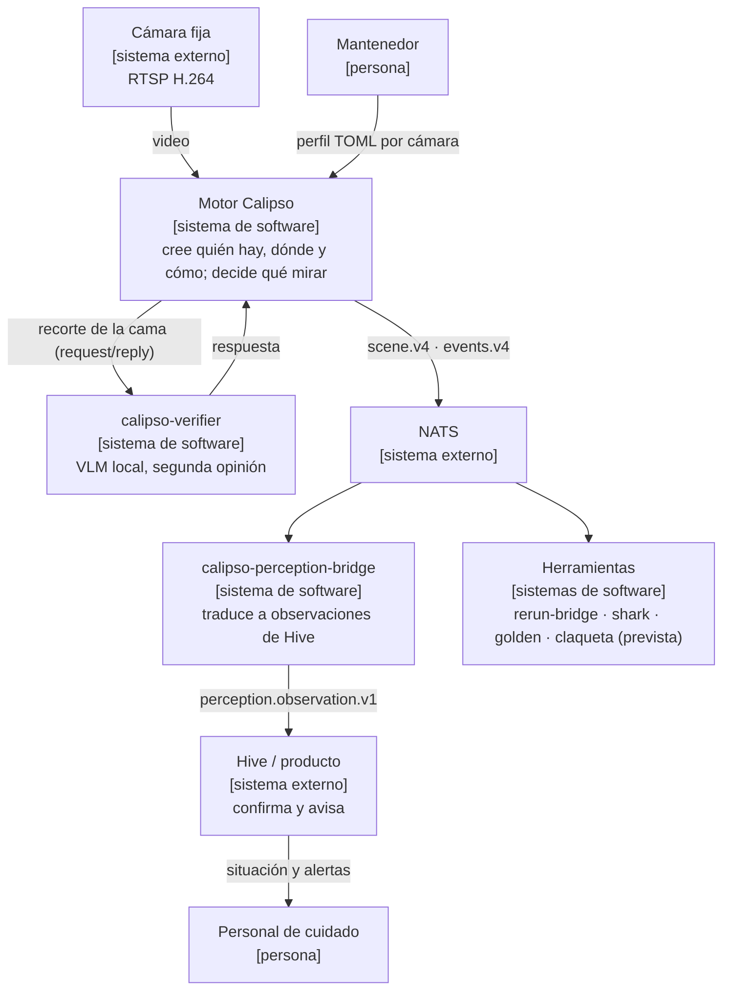
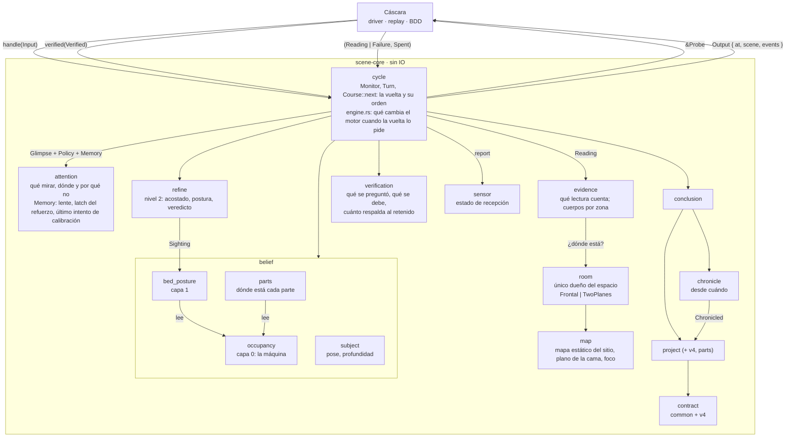
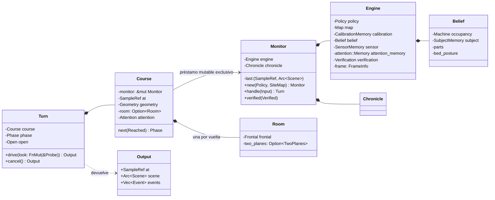
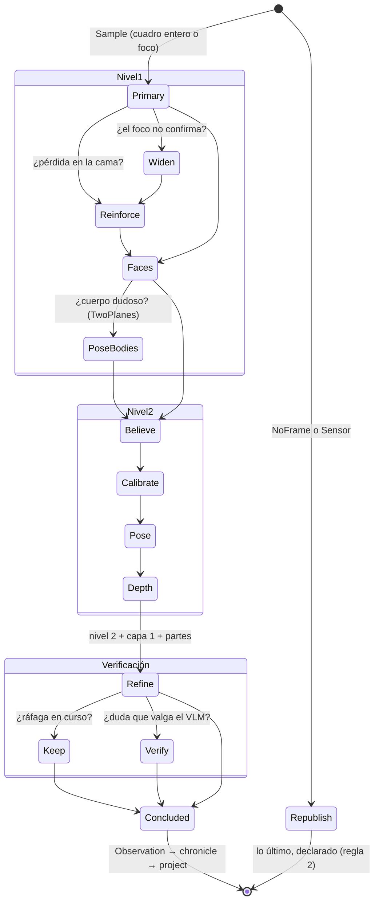
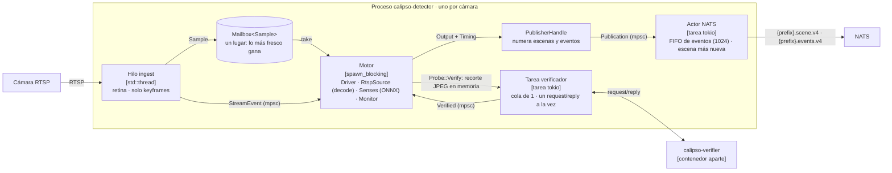
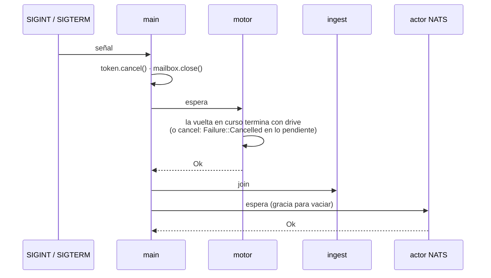
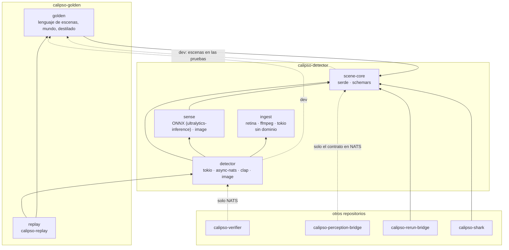
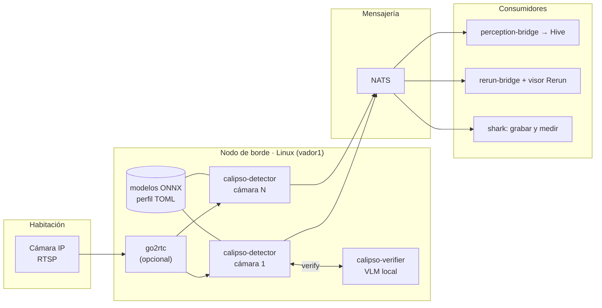
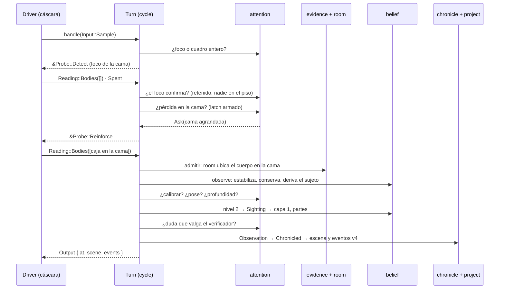

# Arquitectura: 4+1 vistas, con C4 y UML

Revisión por ingeniería inversa del código al **2026-11-01**, `main` en
`7e7f443`: contrato v4, protocolo `drive`/`cancel`, verificador lento, geometría
`Frontal`/`TwoPlanes`. Describe lo implementado; lo previsto se marca como tal.
Si este documento y el código no coinciden, uno de los dos tiene un error: la
referencia del motor es [`crates/scene-core/DESIGN.md`](crates/scene-core/DESIGN.md),
que se compila con `cargo doc`. (El `DESIGN.md` de la raíz es solo un puntero
a ese.)

La revisión de las reglas y la opinión sobre el diseño están en
[revision-2026-11-01.md](../calipso-docs/informes/revision-2026-11-01.md).

El documento sigue las **4+1 vistas** de Kruchten (1995). Cada vista responde
una pregunta para alguien, y los niveles de **C4** (Brown) se ubican en la vista
a la que pertenecen. Los diagramas son Mermaid: `flowchart` para C4 y los
diagramas UML nativos (`classDiagram`, `stateDiagram`, `sequenceDiagram`).

| Vista | Pregunta | Para quién | Diagramas |
| --- | --- | --- | --- |
| [Contexto](#0-contexto-c1) | ¿Qué es y con quién habla? | todos | C1 |
| [Lógica](#1-vista-lógica) | ¿Qué piezas tiene el motor y qué se dicen? | quien diseña o revisa | C3, clases UML, estados UML |
| [Procesos](#2-vista-de-procesos) | ¿Qué corre a la vez y cómo se apaga? | quien opera o integra | C2, secuencia UML |
| [Desarrollo](#3-vista-de-desarrollo) | ¿Cómo está partido el código y qué lo vigila? | quien contribuye | paquetes |
| [Física](#4-vista-física) | ¿Dónde corre? | quien despliega | despliegue |
| [Escenarios (+1)](#5-escenarios-1) | ¿Cómo se sostienen las cuatro vistas en un caso real? | todos | secuencia UML |

## Resumen

El motor es una **biblioteca Rust con estado, determinista y sin IO**,
`scene-core`: una función de `(Policy, SiteMap, Input*, Reading*, Verified*)`.
La conduce un **proceso por cámara**, `calipso-detector`, que recibe RTSP,
decodifica bajo demanda, mira con modelos ONNX, consulta a un verificador lento
fuera de la vuelta y publica `{prefix}.scene.v4` y `{prefix}.events.v4` en NATS.
Los consumidores leen solo el contrato publicado.

El motor **publica la escena y los hechos de cada muestra**. Dentro calcula solo
lo que usa para decidir qué mirar (P7); confirmar en el tiempo y avisar es de
quien consume (hoy, `calipso-perception-bridge`).

Una crate es una unidad de código, no un contenedor C4. Ingesta, sentidos,
núcleo y publicación corren **en un mismo proceso**, en hilos con un dueño
cada uno. El verificador sí es otro contenedor: un servicio aparte detrás de
NATS.

Desde la revisión del 2026-10-11 el núcleo creció en cuatro direcciones:

| Qué entró | Dónde | Spec / tomo |
| --- | --- | --- |
| El foco y su centinela: el detector principal mira la cama mientras el residente está solo en ella | `attention` (`Lens`), `map::focus_region` | proyecto 26, DESIGN §3.1 |
| La geometría como pieza elegida por perfil: `Frontal` o `TwoPlanes` (cama en diagonal), dueña única del espacio | `room/` | white book VII |
| La capa 1 (postura de cama), la ocupación por partes y el veredicto del nivel 2, cada uno con su tabla dorada | `belief/bed_posture`, `belief/parts`, `refine/verdict` | R16–R18, white book I cap. 09–10, II |
| El plano de verificación: preguntas al verificador lento (VLM), ráfagas, respuestas entre vueltas | `verification`, `detector::verifier` | white book III y V, ADR 2026-10-13 |

## 0. Contexto (C1)



El residente es la persona observada; el motor no identifica a nadie y no
guarda imágenes (regla 7). La única salida de píxeles es el recorte de la cama
hacia el verificador, en memoria; guardarlo es del verificador y solo con su
perfil y el consentimiento del sitio.

## 1. Vista lógica

### Componentes del núcleo (C3)



Las flechas son las únicas conversaciones permitidas:

- **`cycle` solo secuencia** (regla 11). Le pasa la `Policy` entera a quien
  decide; `check.sh` lo vigila. `cycle/engine.rs` agrupa los cambios que el
  motor hace en sus memorias, en el orden en que dependen entre sí: la vuelta
  dice cuándo, el motor sabe qué cambiar.
- **`attention` lee y nunca escribe** la creencia: devuelve `Ask(T)` o
  `Skip(reason)` y todo va al ledger (regla 12). Su propia memoria
  (`attention::Memory`: lente, latch, intento de calibración) la anota `cycle`
  después de cada mirada; `attention` solo la lee.
- **El espacio tiene un solo dueño.** `room` responde todas las preguntas de
  espacio con hechos con nombre (`BodyZone`, `HeadArea`), nunca con un plano o un
  polígono. `check.sh` impide que `BedPlane` aparezca fuera de `map` y `room`
  (fixture `space-outside-room`) y que `room` dependa de las capas de arriba
  (fixture `room-reads-a-layer`). La vuelta construye su `Room` una vez.
- **Dónde está la cabeza es del nivel 2.** La conclusión vive en
  `refine/head.rs` y su vocabulario (`HeadPlace`) en `body`; `room` solo
  responde la geometría.
- **Las capas se apilan sin romperse.** La capa 1 y las partes leen la capa 0 y
  nunca cambian una cuenta. El nivel 2 reduce la vuelta a un `Sighting` para la
  capa 1.
- **La verificación es evidencia sobre la creencia, no creencia.** Nunca mueve
  una cuenta y ninguna capa la lee (white book III, frontera 2). Se publica.
- **El dominio no importa el contrato.** Solo `project` traduce, y `cycle`
  nombra el contrato porque `Output` lo lleva. `check.sh` lo vigila.
- **El motor no lee lo publicado** (P4). `chronicle` recuerda el dominio.

Lo público de la biblioteca es `Monitor`, `Turn`, `Input`, `NoFrame`, `Output`,
`contract` (con `contract::v4`), `look` (`Probe`, `Reading`, `Failure`, `Spent`,
`Question`, `Ticket`, `Verified`), `policy`, `map` y `geom`. Todo lo demás es
`pub(crate)`, y `#![warn(unreachable_pub)]` lo vigila.

### Las clases que sostienen la vuelta (UML)



- `Turn` toma prestado `&mut Monitor`: dos vueltas a la vez no compilan.
- `Open` es la obligación de cerrar: solo `drive` o `cancel` la descargan
  (regla 10).
- `Room` no es un trait: es `Frontal` más un `TwoPlanes` opcional que el perfil
  elige. Un segundo uso real, sin `dyn` (regla 18).
- `Monitor::verified` es la **segunda puerta** del núcleo: las respuestas del
  verificador llegan entre vueltas y se asientan al abrir la siguiente.

### Los estados de una vuelta (UML)

El orden vive en un solo lugar, `Course::next` (`cycle/sequence.rs`). Cada
estado lleva lo que la vuelta juntó hasta ahí (`Reached`, `Continuation`).



```text
Primary(foco | entero) → [Widen] → [Reinforce] → [Faces] → [PoseBodies] → believe
  → [Calibrate] → [Pose (+ cabeza) → [Depth]] → refine (nivel 2, capa 1, partes)
  → [Keep (ráfaga)] → [Verify] → conclude
```

Cada mirada es opcional salvo la primaria, y la decide `attention`.

### Las capas por dentro

Las tres máquinas tienen la misma forma: lo visto en la muestra, un *decider*
puro con su **tabla dorada** y una máquina que lo sostiene en tiempo de fuente.

| Capa | Fila | Tabla dorada | Decider |
| --- | --- | --- | --- |
| 0 · ocupación | `rbh[t−1] : fv[t] : contexto → rbh[t] + hechos` | `contract/layer-0-table.txt` | `belief/occupancy/conservation.rs` |
| partes | `l0[t] + lugares[t−1] : visto[t] → lugares[t]` | `contract/parts-table.txt` | `belief/parts/rules` |
| 1 · postura de cama | `l1[t−1] : l0[t] + visto[t] → l1[t]` | `contract/bed-posture-table.txt` | `belief/bed_posture/rules` |
| nivel 2 · veredicto | grupos del cuerpo → acostado / postura | `contract/second-level-table.txt` | `refine/verdict.rs` |

```text
Bodies ──► Span ──(Before, Seen)──► settle ──[Movement]──► Machine::apply ──► Transition
            cuándo cambió             qué lo explica         retenidos, sin explicar,
            (dwell en fuente)         (las reglas)           hechos en orden
```

La máquina devuelve la transición como valor y no la emite (P2). La cuenta
publicada satisface:

```text
room.occupants = floor.seen + bed.seen + len(bed.held)
rbh            = (occupants, bed.seen + held, held)
```

## 2. Vista de procesos

### Contenedores y ejecución (C2)



- **Cada recurso nace y muere en su hilo** (`detector/src/main.rs`). Nada se
  comparte salvo el buzón y los canales.
- **El buzón no encola.** Lo que el motor no toma a tiempo lo reemplaza la
  muestra siguiente, y solo se decodifica lo que el motor va a mirar.
- **El driver no sabe de dónde vienen las muestras ni quién mira.** Se le
  inyectan una `SampleSource`, un `SensesPort` y, si el perfil tiene `[verify]`,
  un `VerifierPort`. En vivo: `RtspSource`, `Senses`, `NatsVerifier`. En
  `calipso-replay`: una escena golden con su mundo y su verificador guionados.
  Mismo driver, mismo núcleo, mismo publicador. Para correr sobre cuadros
  sueltos existe `source::frames` (y el binario `frames`).
- **El verificador no bloquea la vuelta.** `ask` encola y vuelve; las
  respuestas que llegaron se entregan con `Monitor::verified` antes de la
  muestra siguiente. Su plazo (`wall_timeout_secs`) es de reloj de pared y vive
  en la cáscara; el núcleo decide si una respuesta todavía vale por sesión y
  cuerpo retenido (regla 9).
- **El transporte se vuelve dominio en un solo lugar.** El driver traduce cada
  `StreamEvent` a `Input::Sensor` y vigila el plazo sin muestras con
  `Instant` (en la cáscara).
- **La escena nunca espera.** El actor reintenta el frente de la cola de eventos
  con id de mensaje NATS, y de la escena publica siempre la más nueva.
- **Un pánico en la cáscara aborta el proceso** (hook en `main`): lo reinicia
  el supervisor.

### El apagado (UML)



Ninguna vuelta queda abierta: un apagado a mitad de una mirada es un sentido
que falla, y el dominio ya sabe interpretarlo.

## 3. Vista de desarrollo

### Paquetes y dependencias



Tamaño al 2026-11-01 (líneas de `src`, con pruebas en línea): `scene-core` ≈ 12 550, `detector`
≈ 3 600 (de ellas `config.rs` 1 750), `ingest` ≈ 750, `sense` ≈ 600. Los
módulos más grandes del núcleo son `cycle/sequence` (634) y `chronicle` (441).
`attention/` y `evidence/` son carpetas con un archivo por pregunta y por
sentido (mesa de refactor, F-6 y F-7).

- `scene-core` depende solo de `serde` y `schemars`. Clippy prohíbe relojes,
  archivos, red e hilos (`clippy.toml`); `check.sh` verifica el árbol.
- `ingest` no conoce el dominio, `sense` no conoce el transporte asíncrono ni
  recibe políticas (regla 6), y `detector` no depende de `golden` en su build
  normal. Los cuatro árboles los vigila `check.sh`.
- Los consumidores en Rust usan `scene_core::contract::v4`. Un crate de solo
  tipos del cable sigue siendo deuda (DESIGN §11).
- La flecha punteada a `golden` es de desarrollo: sin ciclo en producción.

### Lo que vigila el diseño

Cada guardián tiene una fixture que lo rompe a propósito
(`scripts/check-guardians.sh`): si el guardián no falla, el gate falla.

| Guardián | Regla o principio | Fixture |
| --- | --- | --- |
| Árbol de dependencias del núcleo sin IO | 8 | `core-depends-on-tokio` |
| Clippy: sin relojes ni hilos | 8, 9 | `core-reads-the-clock` |
| `#![deny(...)]`: sin `unwrap`, `expect` ni indexación | 21 | `core-panics` |
| `missing_docs` en la API pública | 13 | `core-undocumented` |
| Snapshots del schema y los ejemplos | 13 | `contract-changes-without-snapshot` |
| `cycle` no pregunta por la política | 11 | `cycle-consults-a-policy` |
| La proyección común no nombra una versión | C2 | `common-projection-names-a-version` |
| El plano de la cama solo en `map` y `room` | 23 | `space-outside-room` |
| `room` no pregunta nada a las capas de arriba | 23 | `room-reads-a-layer` |
| Pasos Gherkin sin definir | 15 | `undefined-step`, `undefined-step-shell` |

Más las tablas doradas de capa 0, partes, lectura de las partes, capa 1 y
nivel 2, con una sola red (`golden::assert_table`): un cambio de regla imprime
las filas que cambiaron y la tabla nueva, y el diff va en el commit. Y cada
perfil de `config/` se carga en una prueba del detector
(`every_profile_in_the_repository_loads`), que `quick.sh` corre cuando cambia
un perfil.

## 4. Vista física



N cámaras son N procesos, cada uno con su perfil (`config/*.toml`). No hay
estado compartido entre cámaras ni persistencia de la creencia: empieza de cero
con el proceso. El repositorio **no tiene manifiesto de despliegue**: «un
proceso por cámara» se verifica en `main.rs`, no en una topología operativa.

## 5. Escenarios (+1)

Cada escenario atraviesa las cuatro vistas. Están en Gherkin en `features/`:
**335 escenarios** al 2026-11-01.

| Carpeta | Escenarios |
| --- | --- |
| `attention/` | 83 |
| `occupancy/` | 51 |
| `posture/` | 41 |
| `bed-posture/` | 24 |
| `contract/` | 24 |
| `verification/` | 19 |
| `parts/` | 17 |
| `shell/` | 76 |

### Una muestra con alguien en la cama que se pierde



### El verificador responde tarde

La vuelta pide `Probe::Verify` con un `Ticket`; el driver encola el recorte y
la vuelta concluye sin esperar. La respuesta llega en otro hilo; el driver la
entrega con `Monitor::verified` antes de la muestra siguiente, y la vuelta de
esa muestra la asienta **solo si lo preguntado sigue en pie**: el mismo cuerpo
retenido, en la misma sesión. Si no, se descarta. Nunca mueve una cuenta.

### El decoder no entrega imagen

`Input::NoFrame` abre una vuelta que no pide nada: republica la última escena,
**declarada** (`republished.reason = decode_failed`), y lo que era actual pasa a
retenido (regla 2).

### Apagado a mitad de una mirada

La señal cancela el token; lo pendiente responde `Failure::Cancelled`, se
publica la escena de esa muestra y el proceso cierra.

### Una noche sin cámara

`calipso-replay` corre una escena golden por el **mismo** driver, con una
`SampleSource` de tramos, un `SensesPort` y un verificador guionados. Como el
núcleo es determinista, la misma noche da las mismas escenas, y
`calipso-distill` vuelve escena una noche publicada.

**La grabación siempre queda fuera del detector.** El detector no graba
nada: grabar es escuchar `scene.v4` y `events.v4` en el bus (`shark`,
`nats sub`, JetStream). Por eso una noche real se repite solo con lo que se
publicó. La escena no lleva píxeles, y la respuesta del verificador se publica
como procedencia (`held.check`), no como lectura: el destilado no la rearma.

## Hallazgos y límites

| Tema | Evidencia | Consecuencia |
| --- | --- | --- |
| Documentos atrasados | Corregido el 2026-11-01: se retiró el `big-picture.md` de la raíz (la visión general vive en `calipso-docs/big-picture.md`) y las citas del white book apuntan a las carpetas nuevas. Sigue abierto: los tomos III y VII dicen «propuesta, sin implementar» y el código ya está en `main` | La regla «si el doc y el código no coinciden, uno tiene un error» no tiene guardián para estos documentos |
| Segunda puerta del núcleo | `Monitor::verified` fuera de `Input` | La grabación está fuera del detector y se rearma desde lo publicado; la respuesta solo se publica como `held.check` y `distill` la saltea. Una noche destilada da las mismas cuentas y capas (la verificación nunca mueve una cuenta), pero no el `held.check`. Aceptado; conviene escribirlo |
| Píxeles en el bus | El recorte va por NATS request/reply a `calipso.verify.v1`, fuera del prefijo `vision.<site>.<camera>` | Como grabar es escuchar el bus, la regla 7 depende de que ningún grabador ni stream de JetStream escuche ese subject (por ejemplo, un `>`). Hoy no tiene guardián |
| Perfil grande | `detector/src/config.rs` ≈ 1 780 líneas | Donde se arma la política. Cada perfil del repositorio ya se carga en una prueba; las combinaciones de capacidades todavía no tienen escena golden por perfil |
| Consumidores atados al núcleo | rerun-bridge y shark dependen de `scene-core` | Deuda: crate de tipos del cable (DESIGN §11) |
| `Input::Sensor` | lleva un `SampleRef` inventado de la última muestra | Deuda: `observed_at` opcional en la próxima versión del contrato |
| `last_event_seq` | lo escribe el actor NATS | Deuda de contrato (DESIGN §11) |
| Profundidad | `meters` y `reference_m` llevan escala relativa | Se renombran en la próxima versión del contrato |
| Despliegue | sin manifiesto en el repositorio | La topología se describe acá; no se verifica |

## Verificación de esta revisión

Revisión **estática** del código en `main@7e7f443`: árbol de módulos, API
pública (`lib.rs`), `cycle`, `attention`, `room`, `verification`, composición
del detector (`main.rs`, `driver.rs`, `verifier.rs`), `scripts/check.sh` y sus
fixtures, conteo de escenarios. **No se corrió** `scripts/check.sh` para esta
revisión (es documentación; el gate completo va por versión, regla 17).

## Fuentes

- Motor: [DESIGN.md](crates/scene-core/DESIGN.md) · [RULES.md](RULES.md) ·
  [protocolo](crates/scene-core/src/cycle.rs) ·
  [orden de la vuelta](crates/scene-core/src/cycle/sequence.rs) ·
  [espacio](crates/scene-core/src/room/mod.rs) ·
  [verificación](crates/scene-core/src/verification.rs)
- Cáscara: [composición](crates/detector/src/main.rs) ·
  [driver](crates/detector/src/driver.rs) ·
  [verificador](crates/detector/src/verifier.rs) ·
  [ingest](crates/ingest/src/lib.rs) · [sentidos](crates/sense/src/lib.rs)
- Decisiones: [ADR](../calipso-docs/adr/), en especial
  [una sola forma de recorrer la vuelta](../calipso-docs/adr/2026-10-11-una-sola-forma-de-recorrer-la-vuelta.md),
  [verificación por VLM con captura](../calipso-docs/adr/2026-10-13-verificacion-vlm-con-captura.md)
  y [verificar al tamaño del cambio](../calipso-docs/adr/2026-10-31-verificar-al-tamano-del-cambio.md).
- Especificación: [white book](../calipso-docs/white-book/README.md).
- P. Kruchten, *The 4+1 View Model of Architecture*, IEEE Software (1995).
  S. Brown, *The C4 model for visualising software architecture*.
