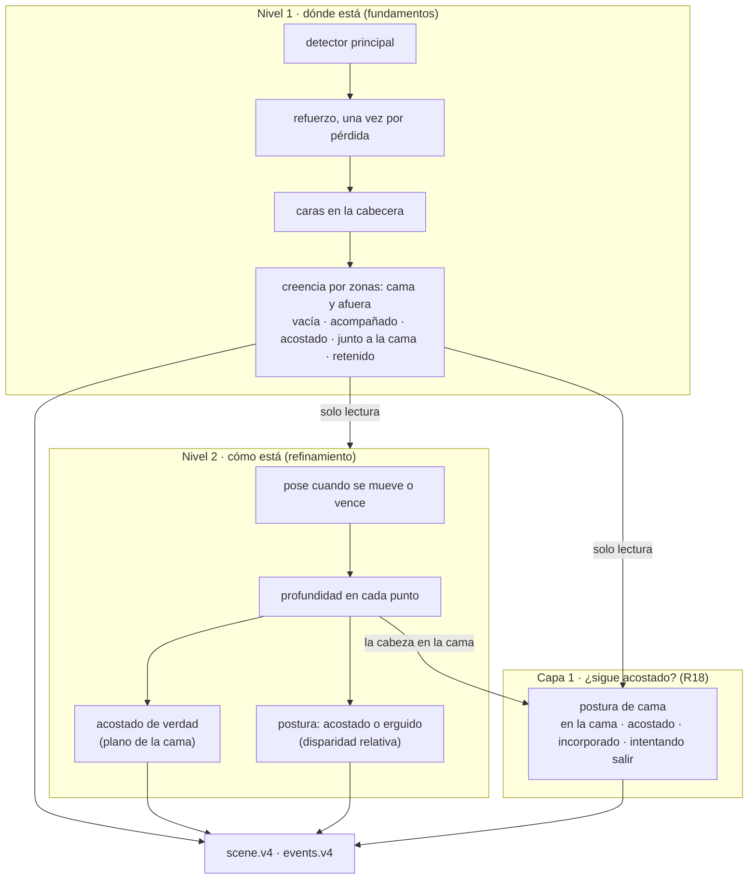
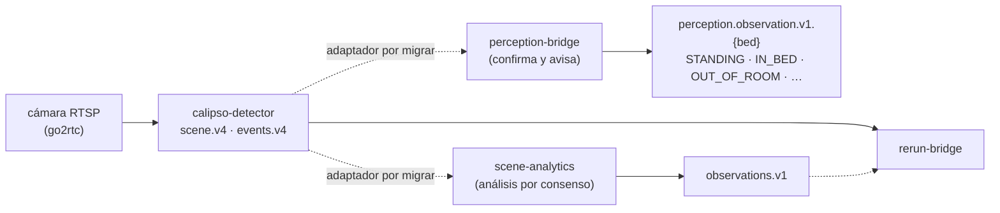

# Calipso — Big picture

Actualizado al **2026-10-13**. Una página para ubicarse: qué es el sistema, cómo
está partido, qué está verificado y dónde mirar. La arquitectura completa, en
4+1 vistas con C4 y UML, está en [arquitectura-c4.md](arquitectura-c4.md); el
detalle, en los documentos enlazados.

## Qué es

Un **gemelo digital de la habitación** para el monitoreo de cama. Una cámara fija
mira la habitación; el motor mantiene una **creencia** sobre quién hay y dónde,
y la publica muestra a muestra con su procedencia. No ve la habitación entera ni
siempre: por eso decide **qué mirar** según lo que cree. Es un **lazo de
percepción activa** ([libro 1](libro/00-prologo.md)) y es **determinista**: con
las mismas lecturas da las mismas escenas, así que una noche se repite sin
cámara.

## El lazo, en capas

- **Nivel 1** es lo que no se negocia: la ocupación por zonas con seis reglas de
  conservación. Un cero no es una ausencia, la cama solo gana a quien vino de
  afuera y un retenido no sale sin reaparecer ([memoria funcional](../specs/r4/00-memoria-funcional.md),
  R4–R6).
- **Nivel 2** lee al primero y nunca lo escribe: si está acostado de verdad, en
  qué postura está y la profundidad de cada punto del cuerpo
  ([libro 2](libro-2/00-prologo.md), R8–R9).
- **Capa 1, la postura de cama** (R18, proyecto 29): al que dejaron acostado,
  ¿sigue acostado, se incorporó o intenta salir? Otra máquina con su tabla, que
  lee la ocupación como entrada y nunca la rompe; decide con dónde está la
  cabeza en la cama y, solo en la cabecera, con la profundidad. Se informa al
  salir de acostado, no al entrar ([libro 3, cap. 10](libro-3/10-la-capa-1-sobre-la-capa-0.md)).
- **El motor hace una cosa y bien** (R9-5): publica hechos por muestra. Suavizar
  en el tiempo, confirmar y avisar es de los consumidores.

## Núcleo y cáscara

| | Núcleo (`scene-core`) | Cáscara (`ingest`, `sense`, `detector`) |
| --- | --- | --- |
| Qué | Creer y decidir qué mirar | Recibir video, mirar con modelos, publicar |
| IO | Ninguno (regla 8) | RTSP, ONNX, NATS |
| Prueba | Gherkin con sentidos guionados y mutaciones; escenas golden | Gherkin `@shell` con modelos guionados; corridas medidas |
| Costura | `handle(Input)` y `drive`: el núcleo pide con `&Probe`, la cáscara responde con una `Reading` | |

Fuera de los dos quedan las herramientas, que leen solo el contrato publicado:
`calipso-rerun-bridge` (dibujar), `calipso-shark` (grabar y medir) y
`calipso-golden` (escenas y replay sin cámara).

Se trabaja siempre en ese orden: primero la política en el núcleo, con su
escenario en rojo; después la capacidad en la cáscara.

## La cadena de la POC

Reemplaza a la cadena anterior (`rtsp-person-detector` + `scene.v1`) con los
mismos consumidores, que leían `scene.v3` a través de un adaptador
(`scenev3`, proyecto 22). La recibe el que **avisa**, perception-bridge, que lee
la escena directamente. scene-analytics queda como capa de análisis y
comparación.

**Abierto:** el motor publica solo v4 desde el 2026-10-11
([retirar v3](adr/2026-10-11-retirar-v3.md)). Antes de la próxima corrida en
vivo hay que llevar a v4 los adaptadores de perception-bridge y
scene-analytics; rerun-bridge ya lee v4.

## Qué está verificado

| Qué | Cómo |
| --- | --- |
| Todo el motor | 186 escenarios Gherkin del núcleo en `scripts/check.sh` (catálogo generado en el [workshop v2](workshop-director-v2/99-catalogo-de-escenarios.md)) |
| Nivel 1 | Los escenarios de `occupancy/` y `attention/`, cada regla con un guardián que se prueba rompiéndolo (`scripts/check-guardians.sh`), mutaciones, propiedades `proptest`, escenas golden S1–S8 y la noche real de sample1 repetida por el detector |
| Nivel 2 | 901–904: escenarios con figuras del cuerpo y mutaciones; medido en vivo sobre sample1 (912) |
| Capa 1 | 17 escenarios (`bed-posture/`), tabla dorada `contract/bed-posture-table.txt`, cada regla con su mutación; **sin medir en noches reales** (vador1 etiquetada en propuesta, proyecto 29) |
| Cáscara | 76 escenarios `@shell`; latencia medida con los cinco sentidos (p90 de la vuelta de 235 a 477 ms contra 1000) |
| Cadena de la POC | Replay de la noche de sample1: 327 escenas → 327 observaciones; perception-bridge da un `STANDING` y un `IN_BED`. En vivo: **pendiente** |

## El mapa de proyectos (calipso-roadmap)

| Proyecto | Qué dejó |
| --- | --- |
| 15 | El lazo y el motor R3 (el libro 1) |
| 16–17 | La infraestructura y la escena v3 en vivo (RTSP → NATS → Rerun) |
| 18 | R5: la creencia no inventa a nadie |
| 19 | R6: refuerzo y caras (política y capacidad) |
| R7 | El motor de replay: escenas golden y destilado de noches |
| 20 | R8: pose, profundidad y calibración (política y capacidad) |
| 21 | R9: el segundo nivel (acostado de verdad, postura, Rerun, medición) |
| 22 | La escena v3 hacia afuera: los consumidores de la POC leen `scene.v3` |
| 23–24 | La capa 0 como máquina pura con observadores; el contrato v4 y el retiro de v3 |
| 25 | Los consumidores de la POC a v4 (**sin empezar**: la cadena hasta el panel está cortada) |
| 26 | El foco en la cama y su centinela |
| 27 | R16: la postura por cabezas (grupos del cuerpo, veredicto en la cama) |
| 28 | R17: la cadera tapada (el centro de la cama, solo con la cabeza en la cabecera) |
| 29 | R18: la capa 1, la postura de cama, y la postura según la cámara |

## Dónde mirar

- **Para trabajar con la dirección médica:** el [workshop v2](workshop-director-v2/00-guia.md), en dos sesiones (ocupación y postura); el [primero](workshop-director/00-guia.md).
- **Qué hace el sistema, para el cuidado:** [documento funcional de la POC v3](funcional-poc-v3.md)
  y [escenarios para el directorio](directorio-escenarios.md).
- **Cómo está construido:** [arquitectura en 4+1 vistas](arquitectura-c4.md) y el
  [DESIGN del motor](../calipso-detector/crates/scene-core/DESIGN.md).
- **Por qué es así:** [libro 1](libro/00-prologo.md), [libro 2](libro-2/00-prologo.md) y [libro 3](libro-3/00-prologo.md) (las tablas de la capa 0 y la capa 1).
- **Qué está hecho y las decisiones:** [specs](specs/README.md) (R4–R18) y los [ADR](adr).
- **Cómo levantar la POC:** `docs/RUNBOOK-SCENE-V3.md` en nats-event-recorder (rama `feat/scene-v3`).
- **Dónde quedamos:** `calipso-roadmap/HANDOFF-2026-10-13.md`.
